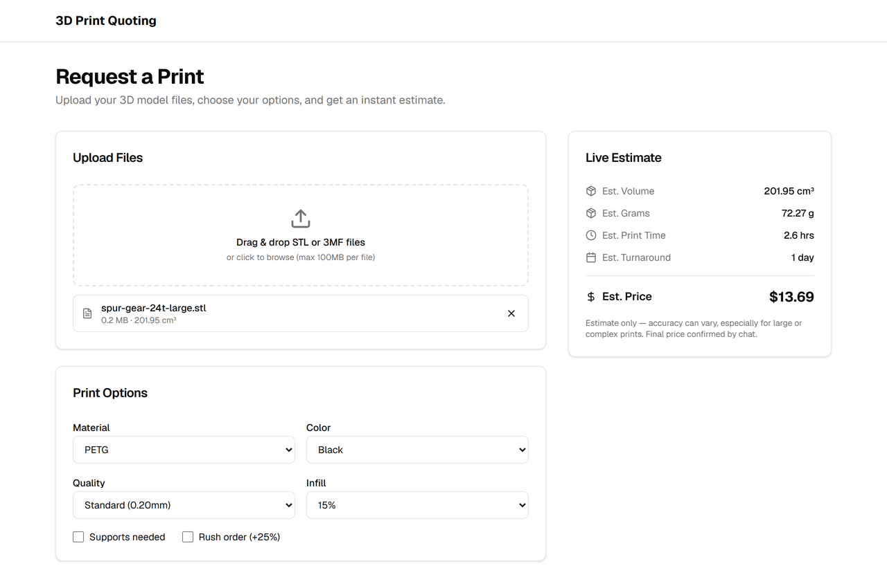
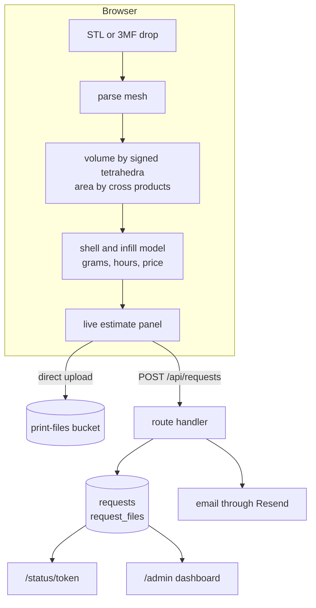
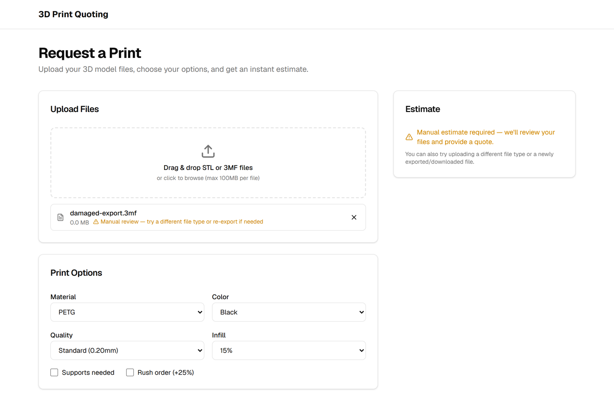

# 3D Print Quoting Site

A storefront for a 3D printing service. A customer drops an STL or 3MF model file (triangle-mesh formats for 3D printing) and the browser computes its solid volume, mass, print time and price without uploading anything. Submitting the request uploads the files, creates a tokenised status page and notifies the owner, who runs the queue from an admin dashboard.

Live at [3d-print-site-ten.vercel.app](https://3d-print-site-ten.vercel.app/).



| Measured in this repository | |
|---|---|
| TypeScript and TSX | 6,699 lines |
| API | 22 route files with 39 method handlers |
| Database | 10 tables, 5 migrations, row-level security on every table |
| Stack | Next.js 16, React 19, Supabase (Postgres, Auth, Storage), Resend |

Built by Zachary Adams in 03/2026 by directing AI coding agents.

## Request lifecycle



## Estimator

The estimator is three small modules with one dependency (a zip reader for 3MF): [`stl-parser.ts`](lib/estimator/stl-parser.ts), [`threemf-parser.ts`](lib/estimator/threemf-parser.ts) and [`calculator.ts`](lib/estimator/calculator.ts).

### Solid volume

Every triangle and the origin form a tetrahedron with a signed volume. Summed over a closed mesh, the parts outside the solid cancel and the true volume remains, wherever the mesh sits in space:

$$V = \left| \sum_i \frac{v_{i1} \cdot (v_{i2} \times v_{i3})}{6} \right|$$

Surface area is half the norm of each triangle's edge cross product, accumulated in the same pass over the file.

### Binary and ASCII detection

Many binary STL exporters write "solid" at the start of the header, so testing for that word misreads them as text. The parser compares the byte length with the length the triangle count implies, 84 + 50n, and accepts a difference under 100 bytes. [`stl-parser.ts`, line 8](lib/estimator/stl-parser.ts#L8)

### 3MF vertex indices

A 3MF file can hold several meshes, and triangle indices are local to each one. An early version pooled every vertex into one list, so a second object's triangles pointed into the first object's geometry. Each `<mesh>` block is now measured on its own and the results are summed. [`threemf-parser.ts`, line 33](lib/estimator/threemf-parser.ts#L33)

### Shell and infill model

A print is a solid outer shell around a sparse internal lattice (infill), so solid volume alone overestimates plastic. With A the surface area and V the solid volume:

| Step | Formula |
|---|---|
| Complexity against a cube of equal volume | c = max(1, A / (6 V^(2/3))) |
| Shell thickness | t = 0.8 mm / c^0.2 |
| Shell and interior | shell = A·t, interior = max(0, V − shell) |
| Effective volume | shell + infill × interior |
| Mass | effective volume × density × waste factor |
| Time | effective volume × 0.04 h/cm³ × multipliers + overhead |

On thin or detailed parts, opposite walls overlap, so area times a fixed thickness counts the same plastic twice. Tapering the thickness with complexity corrects for that and leaves simple parts unchanged. The constants were tuned by hand against real prints and the output of a slicer, the program that turns a model into printer instructions. The time constant is a net throughput of 7 mm³/s. The estimate is advisory; the owner sets `final_price` in the dashboard. [`calculator.ts`, line 49](lib/estimator/calculator.ts#L49)

### Manual review

A file with no measurable volume gets no price. The panel states that the part needs a manual review, and the request can still be submitted. When one of several files is a 3MF that cannot be parsed, the panel prices the rest and marks the estimate as partial.



## Storage and status pages

Vercel functions reject request bodies over 4.5 MB, and print files are often larger. The browser uploads straight to Supabase Storage and the API receives only metadata and storage paths. [`request-form.tsx`](components/request-form.tsx)

Customers have no accounts. Each request gets a 128-bit token from `gen_random_bytes(16)` in the database default, and the status page at `/status/<token>` is keyed by it.

## Data model

| Group | Tables |
|---|---|
| Catalogue | `materials`, `colors`, `material_colors` |
| Pricing | `settings`, with JSONB multiplier maps the owner edits live |
| Requests | `requests`, `request_files` |
| Storefront | `store_items`, `store_item_images`, `store_item_option_groups`, `store_item_option_choices` |

Pricing can change without a deploy. Migration [`005`](supabase/migrations/005_material_pricing.sql) added a per-gram slope with a default of zero, so existing materials kept their price. The speed setting that shipped in [`001`](supabase/migrations/001_initial.sql) was later reinterpreted as a multiplier relative to its seed value, which recalibrated print times without a migration.

## Local setup

```bash
pnpm install
pnpm build                                           # succeeds with no environment variables
node --no-warnings --test tests/estimator.test.mjs   # Node 22.18+
```

The 14 tests were written for this public copy. They feed solids of known volume through the parsers (binary and ASCII cubes, an offset cube, a sphere, a two-object 3MF, unreadable bytes) and check the shell taper, infill, rush and minimum-price rules.

To run the full site, copy `.env.local.example` to `.env.local`, fill in a Supabase project, and apply `supabase/migrations` in order. Replace `owner@example.com` with the admin's address in the code and in the row-level security policies, and `your_handle` with a contact handle.

## Repository map

| Path | Contents |
|---|---|
| `lib/estimator` | Mesh parsing and pricing |
| `components` | Upload, estimate panel, request forms |
| `app/api` | Public and admin route handlers |
| `app/admin` | Queue, settings, catalogue and store management |
| `supabase/migrations` | Schema, policies, storage buckets |
| `tests` | Estimator tests, added for this copy |

[`PROVENANCE.md`](PROVENANCE.md) lists the source revision and what changed for the public copy.
